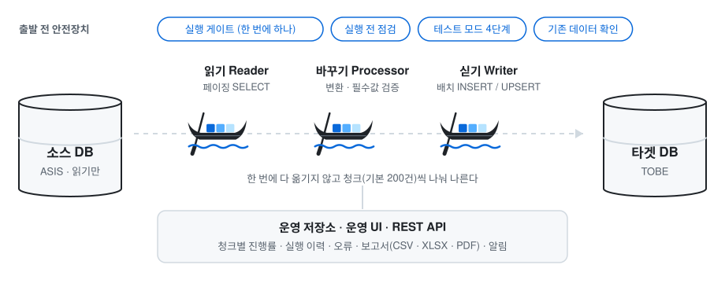

<div align="center">

<picture>
  <source media="(prefers-color-scheme: dark)" srcset="docs/assets/georu-data-migration-logo-dark.svg">
  
</picture>

**거룻배처럼, 데이터를 조금씩 나눠 안전하게 나르는 DB 이관 프레임워크**

Spring Batch 위에서 소스 DB 를 읽고, SQL 과 Java 로 바꾸고, 타겟 DB 에 싣습니다.<br>
실행 전 안전장치 · 단계별 테스트 · 진행률 · 보고서 · 운영 UI 까지 한 번에.

[](https://github.com/dvmoomoodv/georu-data-migration/actions/workflows/ci.yml)
[](LICENSE)


-yellow.svg)

[빠른 시작](#빠른-시작) · [첫 이관 만들기](#첫-이관-만들기) · [문서](#문서) · [기여](#기여)

</div>

---

## 이름: 거루(거룻배)

**거루**는 돛을 달지 않은 작은 배, 거룻배입니다. 큰 배가 닿지 못하는 곳까지 노를 저어 짐을 조금씩 나눠 날랐습니다.

Georu 도 같은 방식으로 일합니다. 큰 DB 를 한 번에 옮기지 않고 **청크(기본 200건) 단위로 나눠**, 한 번에 한 척씩, 출발 전에 점검하고 도착할 때마다 기록하며 나릅니다.

## 왜 Georu 인가

시스템을 바꿀 때마다 이관은 SQL 스크립트 묶음과 엑셀 대사표로 다시 만들어집니다. 그리고 매번 같은 사고가 납니다. 두 사람이 동시에 돌리고, 테스트하다 운영 데이터를 덮고, 몇 건이 빠졌는지 끝나고 나서야 압니다.

Georu 는 실제 이관 프로젝트 두 곳(Oracle → MySQL, MSSQL → MySQL)에서 쓰던 엔진을 업체 코드와 분리해 공개한 것입니다. 사람이 쓰는 것은 **변환 규칙(SQL · Java)** 뿐이고, 실행 · 안전장치 · 기록 · 보고는 프레임워크가 맡습니다.

<picture>
  <source media="(prefers-color-scheme: dark)" srcset="docs/assets/how-it-works-dark.svg">
  
</picture>

## 특징

**안전하게**
- **실행 게이트**: 시스템 전체에서 한 번에 하나만 실행합니다. 다른 실행이 돌고 있으면 거절합니다(409).
- **실행 전 점검**: 컬럼 길이 · NOT NULL · 타입 · PK 중복을 미리 봅니다. 타겟에 기존 데이터가 있으면 경고하고 멈춥니다.
- **테스트 모드 4단계**: `READER_TEST` → `PROCESSOR_TEST` → `WRITER_TEST`(최대 100건) → `NORMAL`.
- **지우지 않습니다**: 제품은 TRUNCATE · DELETE 를 실행하지 않습니다. 정리는 사람이 합니다.

**코드로**
- 테이블 하나에 사람이 쓰는 파일은 **Source SQL · Target SQL · Processor(필요할 때만)** 세 개입니다. Reader · Writer · Strategy 는 엔진이 만듭니다.
- 변환 규칙이 MyBatis SQL 과 Java 이므로 버전 관리 · 코드 리뷰 · 단위 테스트를 그대로 씁니다.
- 여러 DataSource, N:1 병합, 1:N 복제, 다른 DB 값 결합(`SourceLookup`), 시퀀스 채번을 지원합니다.

**보이게**
- 청크별 진행률, 실행 이력(요청 JSON 포함), 로그 · 오류, 빠진 행 채우기.
- 보고서 JSON · CSV · XLSX · PDF, 텔레그램 · UI 알림, 시스템 부하 추이.
- 운영 UI(`/ui`)와 REST API(Swagger). 로그인 · 메뉴별 권한(조회 · 실행)을 갖춥니다.

**도구**
- 이관 설계: TOBE 정의 xlsx → 코드 초안 zip, 이름 기준 관계 분석, 매핑 정의서 초안.
- 엑셀 이관: 타겟 컬럼 형식의 xlsx · csv 를 올려 같은 파이프라인으로 적재.

## 빠른 시작

Docker(Compose v2)와 메모리 8GB 이상이면 데모를 바로 돌려 볼 수 있습니다. 데모는 Oracle `DEMO` 12 테이블을 MySQL `demo_tobe` 로 옮깁니다.

```bash
git clone https://github.com/dvmoomoodv/georu-data-migration.git
cd georu-data-migration/examples/demo
cp docker/.env.example docker/.env
./run-scripts/run-docker.sh db       # Oracle + MySQL (Oracle 첫 기동 3~5분, 데모 데이터 자동 적재)
./run-scripts/run-docker.sh build    # 앱 이미지 빌드
./run-scripts/run-docker.sh up       # → http://localhost:8083
```

처음 접속하면 관리자 계정을 만드는 화면이 나옵니다. 로그인한 뒤 **안내서 → 데모 시작 가이드**를 따라 12 테이블을 차례로 옮기고, 건수 · 채번 범위를 가이드의 표와 비교해 보세요.

| 접속 | 주소 |
|---|---|
| 운영 UI | http://localhost:8083/ui |
| 안내서 | http://localhost:8083/ui/guide |
| Swagger | http://localhost:8083/swagger-ui/index.html (관리자) |
| Health | http://localhost:8083/actuator/health |

UI 없이 API 로도 실행할 수 있습니다. 먼저 Reader 만 5건 읽어 소스 SQL 을 확인합니다(적재 없음).

```bash
curl -u admin:<비밀번호> -X POST http://localhost:8083/api/migrate/table \
  -H "Content-Type: application/json" -d '{
    "pluginName": "demo.member", "tableName": "tb_member_grade",
    "tenantLevel1": "DEMO", "tenantLevel2": "DEMO", "tenantLevel3": "DEMO", "tenantLevel4": "DEMO", "tenantLevel5": "DEMO",
    "testMode": "READER_TEST", "testMaxItems": 5 }'
```

> `testMode` 를 빼면 `NORMAL`(전량 적재)입니다. 테스트할 때는 반드시 적으세요.

## 첫 이관 만들기

앱은 스타터 하나에 의존합니다. 엔진 · API · 운영 UI 는 자동 설정이 등록합니다.

```groovy
dependencies {
    implementation 'com.georu:georu-spring-boot-starter:0.0.1'
    testImplementation 'com.georu:georu-test:0.0.1'
}
```

> 아직 Maven Central 에 배포하지 않았습니다. 지금은 `./gradlew publishAllPublicationsToBundleRepository` 로 만든 `build/repo` 를 앱 저장소의 `libs/` 에 넣어 씁니다. 자세한 방법은 안내서(`/ui/guide`)의 시작하기를 보세요.

업무 단위(플러그인)마다 카탈로그 클래스 하나에 옮길 테이블을 적습니다. 이름은 모두 **타겟(TOBE) 테이블** 기준입니다.

```java
@GeoruPlugin(name = "demo.member", description = "회원", source = "oracle", target = "mysql")
public class DemoMemberPlugin implements TableCatalog {
    public List<TableDef> tables() {
        return List.of(
            TableDef.of("tb_member_grade", TbMemberGradeSourceDto.class, TbMemberGradeTargetDto.class)
                    .processor(TbMemberGradeProcessor.class),
            TableDef.of("tb_member", TbMemberSourceDto.class, TbMemberTargetDto.class)
                    .processor(TbMemberProcessor.class));
    }
}
```

테이블마다 Source SQL(`selectTotalCount` · `selectPageData`)과 Target SQL(`insertData`)을 MyBatis XML 로 쓰고, 변환 · 검증이 필요하면 `AbstractItemProcessor` 를 상속한 Processor 를 붙입니다. 전체 예는 [`examples/demo`](examples/demo)에 있습니다.

`georu-test` 로 여러 DataSource 를 H2 로 띄워 단위 하나를 실제 Step 으로 시험할 수 있습니다.

```java
try (GeoruTestDataSources dbs = GeoruTestDataSources.h2("source-m", "source-1", "target-m")) {
    dbs.jdbc("source-1").execute("CREATE TABLE BR_MEMBER (...); INSERT INTO BR_MEMBER ...");
    dbs.jdbc("target-m").execute("CREATE TABLE stg_member_all (...)");
    try (GeoruTestDataSources.Context ctx = dbs.start(MyCatalog.class)) {
        assertThat(ctx.run("stg_member_br").getStatus()).isEqualTo(BatchStatus.COMPLETED);
    }
    assertThat(dbs.count("target-m", "stg_member_all")).isEqualTo(280);
}
```

## 문서

| 문서 | 내용 |
|---|---|
| 운영 UI › 안내서 (`/ui/guide`) | 데모 · 새 테이블 추가 · 매핑 규칙 · 여러 DataSource · JDBC 드라이버 · 다시 돌리기 · 문제 해결 ([원문](georu-api/src/main/resources/guides)) |
| [CHANGELOG.md](CHANGELOG.md) | 버전마다 바뀐 공개 API 와 옮기는 방법 |
| Swagger (`/swagger-ui/index.html`) | 모든 REST API 의 요청 · 응답 · 필드 설명 |

## 저장소 구조

```
georu-core/                       엔진: 실행 게이트 · Strategy · 실행 전 점검 · 채번 · 시나리오 · 운영 저장소
georu-api/                        REST API · 보고서(CSV · XLSX · PDF) · 안내서
georu-codegen/                    이관 설계 도구 (코드 생성 · 관계 분석 · 매핑 정의서)
georu-ui/                         운영 UI (Thymeleaf) · 로그인 · 권한
georu-spring-boot-autoconfigure/  자동 설정
georu-spring-boot-starter/        앱이 의존하는 묶음
georu-test/                       플러그인 테스트 도구
examples/demo/                    데모 앱 · 로컬 Docker DB 환경
```

## 기술 스택

Java 17 · Spring Boot 3.2 · Spring Batch 5 · MyBatis 3 · Thymeleaf · springdoc OpenAPI · Apache POI · openhtmltopdf.
DB 종류는 JDBC URL 로 판단합니다. 데모는 Oracle → MySQL 이고, 여러 DB 예제(`xdb`)는 PostgreSQL · SQL Server → MariaDB 를 함께 돌립니다.

## 지금 상태

- **0.x 베타**입니다. 1.0 전까지 공개 API 와 설정 키가 바뀔 수 있고, 바뀔 때는 CHANGELOG 에 옮기는 방법을 적습니다.
- 실행 게이트는 프로세스 안에서만 유효합니다. 앱 1대 운영을 전제로 합니다.
- 실행 전 점검과 시퀀스 동기화는 타겟 접속의 기본 DB 에서 테이블을 찾습니다.

## 기여

이슈 · 문서 수정 · 코드 기여 모두 환영합니다. 시작하기 전에 [CONTRIBUTING.md](CONTRIBUTING.md)와 [행동 강령](CODE_OF_CONDUCT.md)을 읽어 주세요. 보안 취약점은 공개 이슈 대신 [SECURITY.md](SECURITY.md)의 절차로 알려 주세요.

## 라이선스

[Apache License 2.0](LICENSE). 포함된 서드파티 자원은 [NOTICE](NOTICE)에 있습니다.
